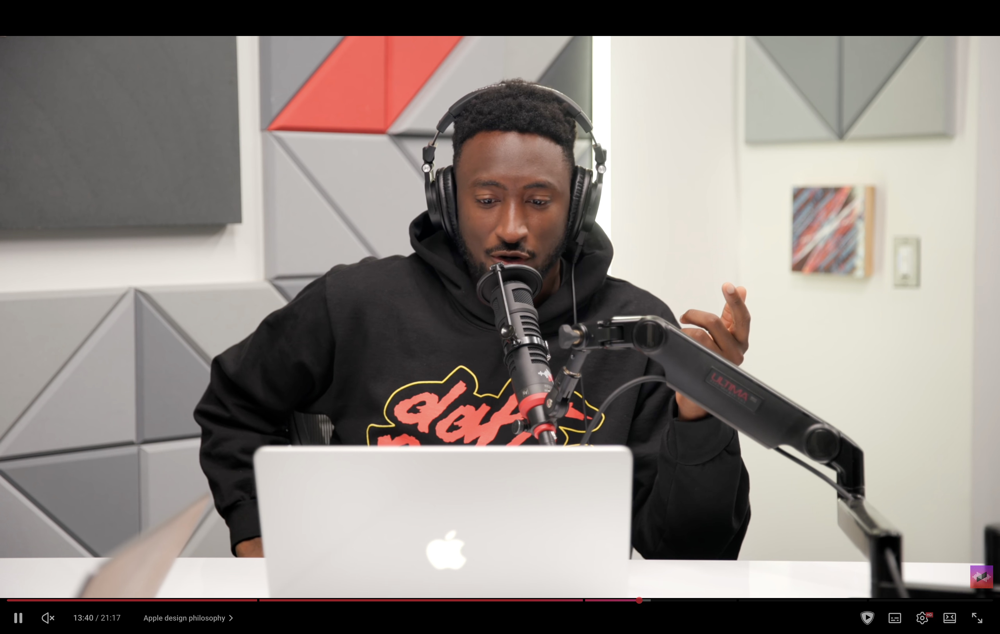

# Video Windowed Fullscreen (macOS)

A userscript for Chromium browsers on macOS: videos go full screen **in the Space you are
already in** — no native macOS fullscreen, no new Space, no animation.



Works in Chrome, Brave, Edge, Vivaldi, Opera, Helium, Ardia, Arc — any Chromium browser that
runs userscripts (Tampermonkey / Violentmonkey), or the built-in userscripts in Ardia.

## The problem

On macOS, Firefox has a pref for this:

```
full-screen-api.macos-native-full-screen = false
```

Chromium has no equivalent — not a flag, not a pref, not a fork option. Every fullscreen
request goes to AppKit (`toggleFullScreen()`), so the video is moved to its own Space, the
screen animates, and coming back costs another animation. The Chrome team calls it
intentional (the "immersive" toolbar behaviour); Brave closed the same request as
"follow Chromium".

## What the script does

Whichever element asks for fullscreen, the script answers the call itself instead of letting
it reach AppKit:

- the element is pinned over the window (`position: fixed`, `inset: 0`, `z-index` on top,
  black background), page scroll locked;
- a `resize` is dispatched so the player recomputes its video geometry for the new box;
- a second request for the same element, `document.exitFullscreen()`, or `Esc` puts
  everything back.

`document.fullscreenElement` stays `null` and no Space is created.

Which requests are hijacked:

| Request | Result |
| --- | --- |
| anything containing a `<video>`, or the `<video>` itself | windowed fullscreen |
| `<html>`/`<body>` with a video somewhere on the page (YouTube) | windowed, pinned to the player |
| canvas games, editors, maps — no video inside | real macOS fullscreen, untouched |
| any request with **Shift** held | real macOS fullscreen |
| a player inside a cross-origin iframe (Vimeo/YouTube embeds) | real macOS fullscreen — the frame cannot resize its parent |

On YouTube the masthead and the "below the player" column (title, channel, buttons) are
hidden while expanded, because they live in higher stacking contexts and would paint over the
pinned player. Real fullscreen hides them too.

## Install

**Tampermonkey / Violentmonkey** — install the extension, then open
**[install the script](https://raw.githubusercontent.com/iva-zhu/windowed-fullscreen/main/windowed-fullscreen.user.js)**
and confirm.

**Ardia** (built-in userscripts, no extension):

```sh
git clone https://github.com/iva-zhu/windowed-fullscreen
ardia scripts install windowed-fullscreen/windowed-fullscreen.user.js
```

**Anything else** that reads a `// ==UserScript==` block.

## Use

- YouTube: double-click the video or the `⛶` button; `Esc` or another double-click collapses.
- Any other player: its own fullscreen button / `f` key / double-click, whatever it uses —
  it all ends in the Fullscreen API.
- Need the real macOS fullscreen (a game, a second display)? Hold **Shift** and hit the same
  button, or disable the script for that site.

## Notes

- **It fills the browser window, not the physical screen.** That is the trade-off: the page
  cannot move or resize the window, and doing that through AppKit is exactly what creates a
  Space. So make the window cover the screen *without* native fullscreen first — with
  [AeroSpace](https://github.com/nikitabobko/AeroSpace), for example:
  `fullscreen --no-outer-gaps` (or bind it: `cmd-ctrl-alt-f = 'fullscreen --no-outer-gaps'`).
  Any tiling WM with an emulated fullscreen works.
- Black bars are normal: a 16:9 video in a non-16:9 window is letterboxed exactly as it
  would be in native fullscreen.
- A few players only relayout on `fullscreenchange` instead of on `resize`; those may keep
  their pre-fullscreen video size inside the expanded box. YouTube, Vimeo-less HTML5 video
  and the browser's native `<video>` controls are fine.
- Single-letter keys (`f`, etc.) belong to Vimium-like extensions when they are installed.

## Known-good

| Browser | Version | OS |
| --- | --- | --- |
| Ardia | 0.2.45 (Chromium 1xx) | macOS 26 |
| Tampermonkey | 5.x | — |

Tested players: YouTube watch page, plain `<video>` pages, the browser's native video
controls.

## License

MIT — see [LICENSE](LICENSE).
